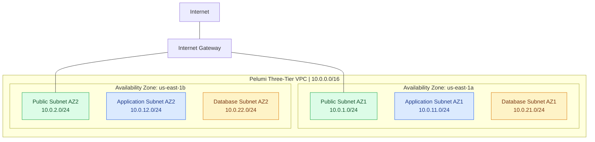

# AWS Three-Tier Architecture Diagram

## Network Architecture

The diagram below represents the configured AWS network foundation in the us-east-1 region.

## Routing Configuration

| Tier | Route Table | Internet Access |
|---|---|---|
| Public | pelumi-public-rt | Via Internet Gateway |
| Application | pelumi-private-app-rt | No direct internet route |
| Database | pelumi-isolated-db-rt | No direct internet route |

All three route tables include the VPC's local route.

## Deployment Status

| Component | Status |
|---|---|
| VPC | Configured |
| Six subnets | Configured |
| Internet Gateway | Attached |
| Route tables | Configured |
| Security groups | Configured |
| EC2 web application | Deployed and validated |
| Application Load Balancer | Successfully tested, then deleted |
| Target group | Successfully tested, then deleted |
| RDS subnet group | Created |
| RDS database instance | Not deployed |
| NAT Gateway | Not deployed |

## Application Deployment Note

The existing EC2 web application is operational.

Its exact subnet placement must be verified before including the instance in a diagram that claims deployment inside the private application tier.

The application is accessible through its public IPv4 address.

## Architecture Design Considerations

- Multi-Availability Zone subnet distribution
- Logical separation of public, application, and database tiers
- Dedicated routing per tier
- Restricted network access using security groups
- No NAT Gateway to reduce costs
- No active RDS database instance
- Temporary load balancer resources removed after validation

This diagram documents the network foundation, not a fully deployed production-ready three-tier application.
