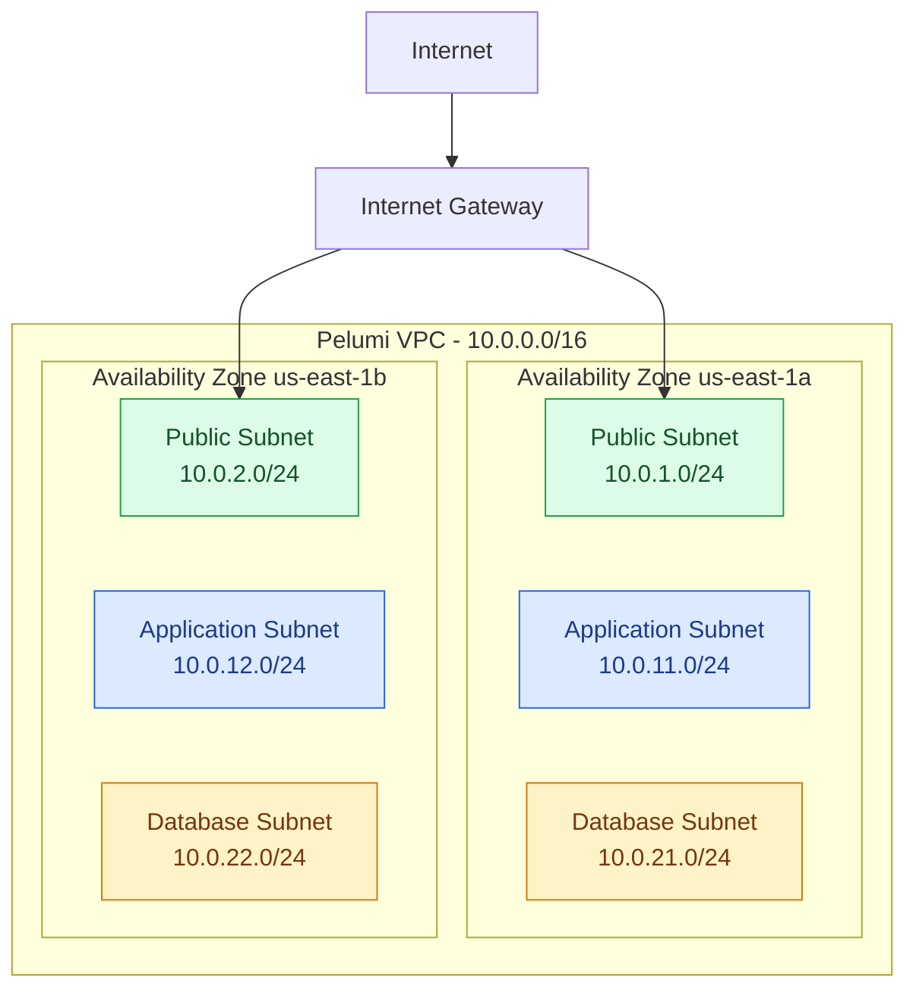

# AWS Three-Tier Architecture

**Region:** us-east-1 (N. Virginia)

## Routing Design

| Tier | Route table | Routing |
|---|---|---|
| Public | `pelumi-public-rt` | Local route and Internet Gateway default route |
| Application | `pelumi-private-app-rt` | Local route only |
| Database | `pelumi-isolated-db-rt` | Local route only |

## Implementation Status

- VPC and six subnets: configured
- Internet Gateway: attached
- Security groups: configured
- EC2 web application: deployed and validated
- Application Load Balancer: tested, then deleted
- RDS subnet group: created
- RDS database instance: not deployed
- NAT Gateway: not deployed

**Note:** The subnet grouping shows the intended network design. The EC2 instance's actual subnet placement must be verified before describing it as deployed in the private application tier.
