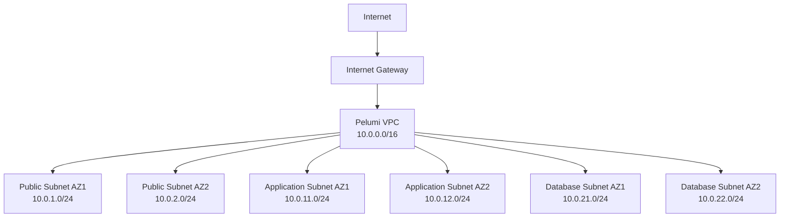

# AWS Three-Tier Architecture

**Region:** us-east-1 (N. Virginia)

## Network Design

- One VPC with CIDR 10.0.0.0/16
- Six subnets across two Availability Zones
- Public subnets have routes to the Internet Gateway
- Application subnets use local-only routing
- Database subnets use local-only routing
- No NAT Gateway was deployed

## Deployment Status

- EC2 web application: deployed and tested
- Application Load Balancer: tested, then deleted
- RDS subnet group: created
- RDS database instance: not launched
